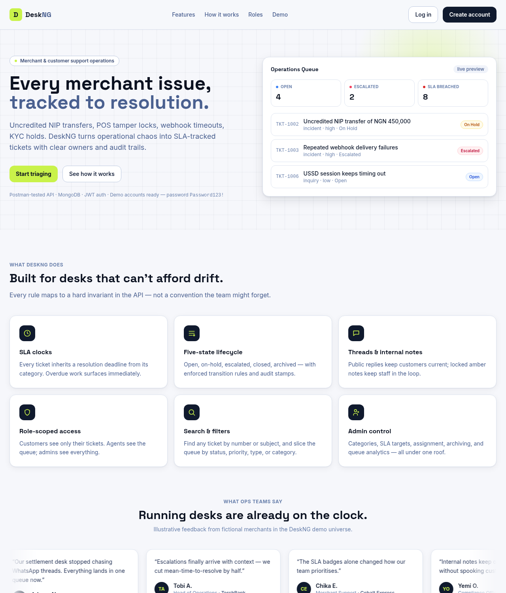
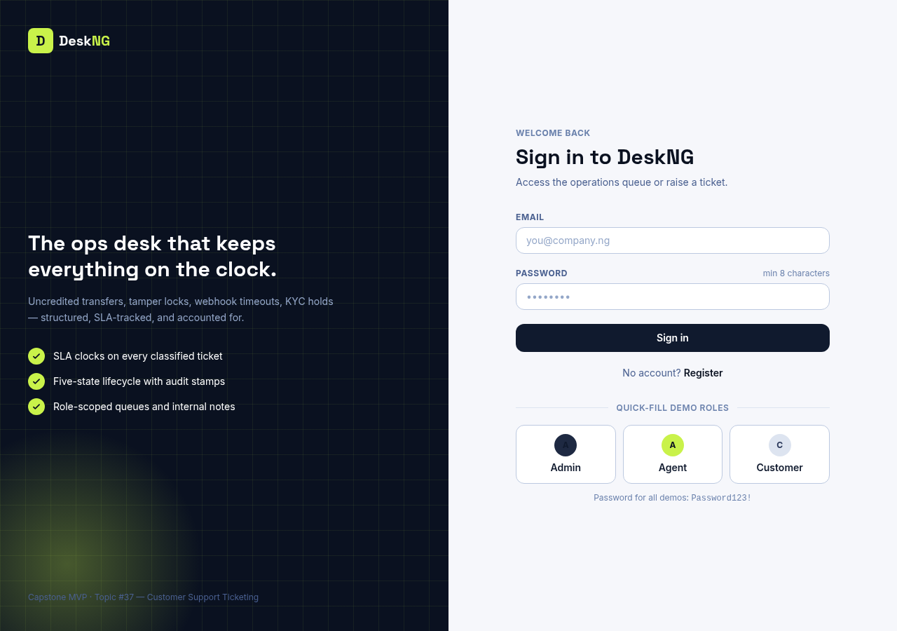
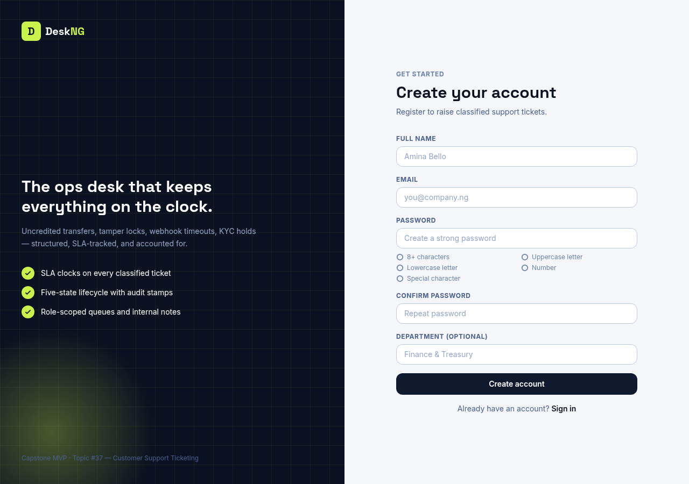
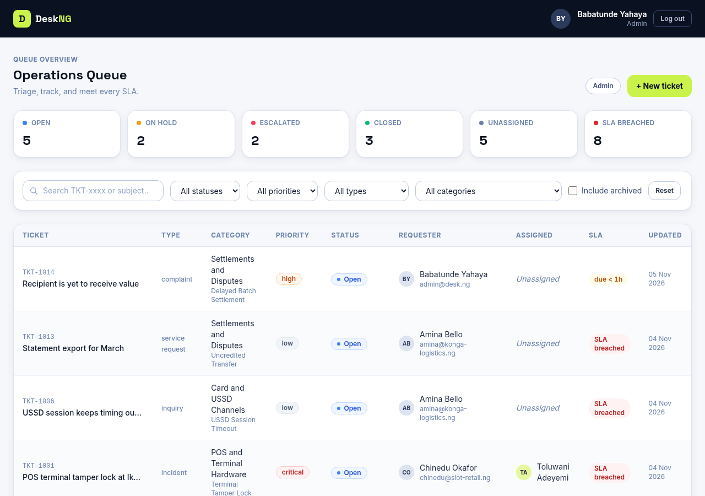
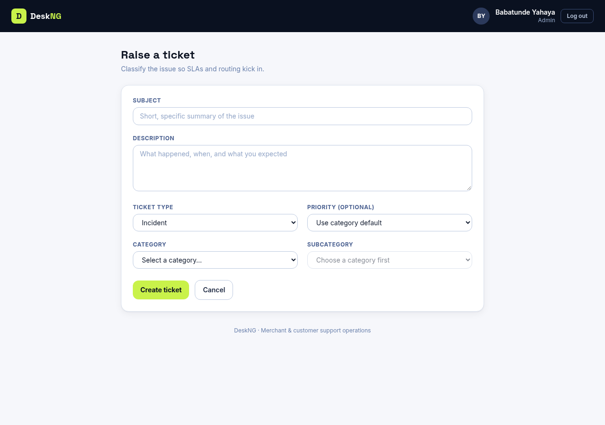
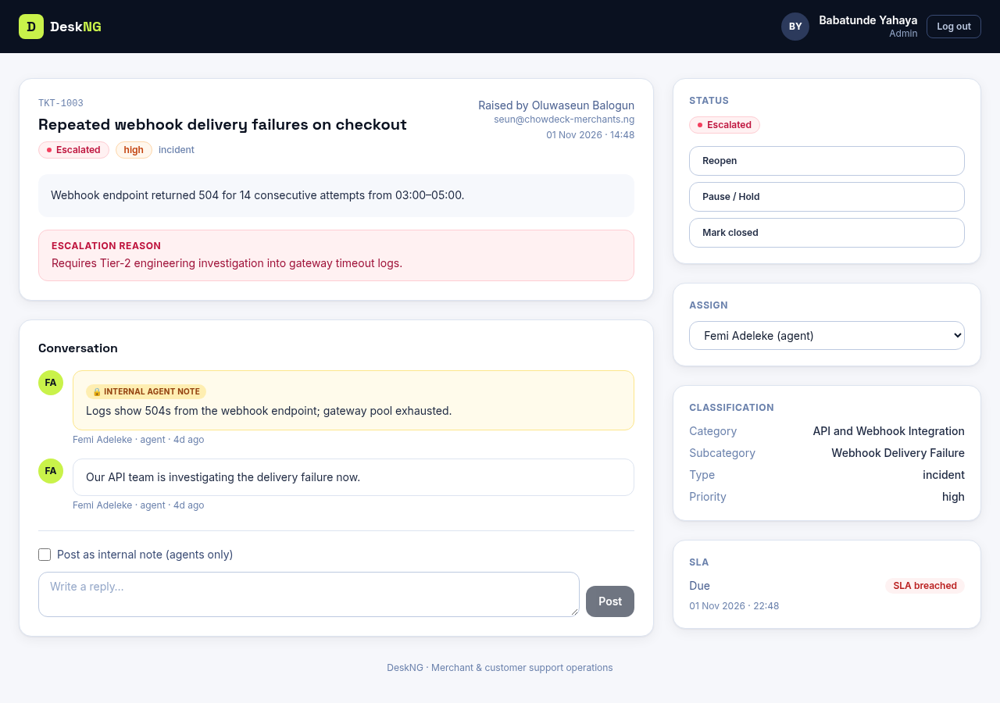
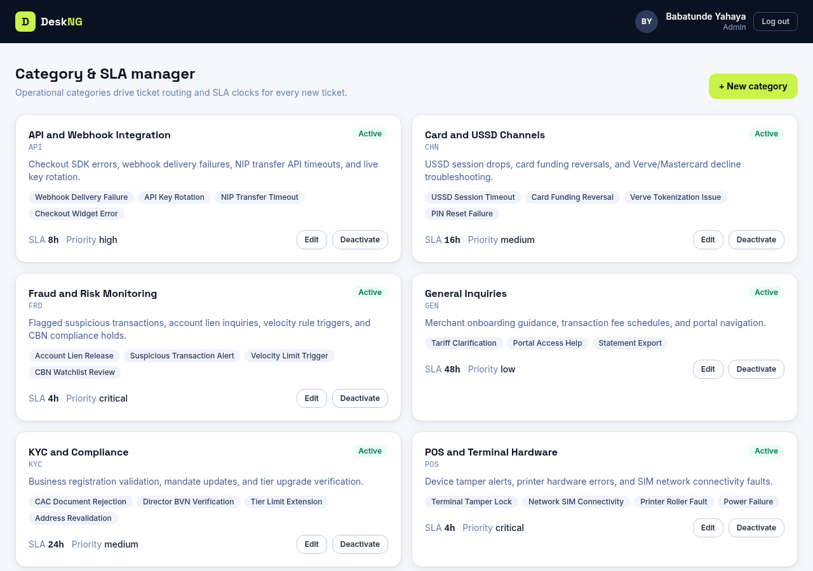

# DeskNG — Customer Support Ticketing MVP

A role-based support ticketing and SLA triage platform for
Nigerian merchant operations. Customers raise classified tickets,
agents triage against automated SLA clocks, and operations leaders
monitor queue health — no more threading high-stakes issues
through WhatsApp and email.

**Capstone topic:** #37 Customer Support Ticketing (TS Academy)

---

## Table of Contents

- [Overview](#overview)
- [Screenshots](#screenshots)
- [Features](#features)
- [Tech Stack](#tech-stack)
- [Repository Layout](#repository-layout)
- [Getting Started](#getting-started)
- [Configuration](#configuration)
- [Seeded Data & Credentials](#seeded-data--credentials)
- [API Reference](#api-reference)
- [Domain & Business Rules](#domain--business-rules)
- [Testing Guide](#testing-guide)
- [Frontend & Design System](#frontend--design-system)
- [Troubleshooting](#troubleshooting)
- [Project Status](#project-status)

---

## Overview

Payment processors, logistics platforms, and retail merchants
handle high-stakes operational issues daily: uncredited NIP
transfers, POS terminal tamper locks, webhook timeouts, and KYC
compliance holds. DeskNG provides a unified workflow where every
issue becomes a classified ticket with an owner, a due time, and
a full audit trail.

The system enforces strict separation of concerns:

```text
routes -> middleware/validators -> controllers -> services -> models
```

---

## Screenshots

Captured from the live MVP (1280px wide, Chrome headless).

**Landing page — hero with product preview and testimonial ticker**



**Login — split-screen with quick-fill demo roles**



**Register — with live password-rule checklist**



**Operations Queue — KPI bar, filters, paginated SLA table**



**Create ticket — category to subcategory with SLA preview**



**Ticket detail — conversation thread, transitions, assignment**



**Admin — category & SLA manager**



---

## Features

- **Role-based access (RBAC)** — customers, agents, and admins
  see exactly the data their role permits.
- **Three-dimensional classification** — type (`incident`,
  `service_request`, `inquiry`, `complaint`), category/subcategory
  (linked to a `Category` document), and priority (defaults to
  the category's `defaultPriority`).
- **Five-state lifecycle** — `open`, `on_hold`, `escalated`,
  `closed`, `archived`, with enforced transition rules and
  timestamp stamps.
- **Automated SLA clocks** — `dueAt` is computed at creation from
  the category's `slaHours`; queue views surface breach and due
  states.
- **Conversation threads** — public replies visible to customers;
  `isInternal` notes visible only to staff (stripped from
  customer responses).
- **Operations queue** — KPI analytics, multi-filter search,
  pagination, assignment, and archive from a single dashboard.
- **Admin controls** — category/subcategory/SLA management and
  the active-staff directory.

---

## Tech Stack

| Layer | Technology |
| --- | --- |
| Backend | Node.js (ES Modules), Express 5, Mongoose 9 |
| Validation | Zod (body/query/params schemas) |
| Auth | JWT (Bearer), bcryptjs password hashing |
| Database | MongoDB (local) |
| Frontend | React 18, Vite 5, Tailwind CSS 3, React Router v6 |
| HTTP client | Axios with Bearer-token interceptor |
| Security | helmet, cors (allowlist), 10kb JSON body limit, env validation |

---

## Repository Layout

```text
support-ticketing-mvp/
├── README.md                # this file
├── docs/
│   ├── prd.md               # product requirements
│   ├── spec.md              # technical specification & API contracts
│   └── session-memory.md    # agent working notes & checkpoint log
├── backend/
│   ├── .env                 # local environment config
│   ├── package.json
│   └── src/
│       ├── app.js           # Express pipeline
│       ├── server.js        # DB bootstrap & HTTP listener
│       ├── config/          # env.js (Zod), db.js (Mongoose)
│       ├── models/          # User, Category, Counter, Ticket, TicketMessage
│       ├── routes/          # auth, category, user, ticket routes
│       ├── controllers/     # thin HTTP layer
│       ├── services/        # domain & database logic
│       ├── middleware/      # protect, authorize, validate, error handling
│       ├── validators/      # Zod schemas
│       └── utils/           # AppError, apiResponse, asyncHandler, token, seeder
└── frontend/
    ├── .env                 # VITE_API_URL
    ├── package.json
    └── src/
        ├── api/client.js    # Axios instance + interceptors
        ├── context/AuthContext.jsx
        ├── components/      # AppShell, AuthLayout, ui primitives, ticker
        ├── pages/           # Landing, Login, Register, Dashboard, CreateTicket, TicketDetail, AdminCategories
        ├── App.jsx          # routes + guards
        └── main.jsx
```

---

## Getting Started

### Prerequisites

- Node.js 20+ (developed on v24)
- MongoDB running locally at
  `mongodb://127.0.0.1:27017`
- npm 10+

### 1. Backend

```bash
cd backend
npm install
npm run seed    # seeds 8 categories, 12 users, 12 tickets, messages
npm run dev     # nodemon -> http://localhost:5001
```

Verify: `GET http://localhost:5001/api/health` returns
`{"success": true, ...}`.

### 2. Frontend

```bash
cd frontend
npm install
npm run dev     # Vite -> http://localhost:5174
```

Open **http://localhost:5174** in a browser.

> Note on ports: this machine runs sibling projects that occupy
> ports 5000 and 5173. DeskNG therefore uses **5001** (backend)
> and **5174** (frontend); the backend CORS allowlist covers both
> 5173 and 5174.

---

## Configuration

### Backend (`backend/.env`)

| Variable | Example | Purpose |
| --- | --- | --- |
| `NODE_ENV` | `development` | Runtime mode |
| `PORT` | `5001` | HTTP port (5000 is taken by a sibling project) |
| `MONGO_URI` | `mongodb://127.0.0.1:27017/support_ticketing_db` | Local MongoDB connection string |
| `JWT_SECRET` | (32+ chars) | Token signing secret |
| `JWT_EXPIRE` | `7d` | Token lifetime |
| `CORS_ORIGIN` | `http://localhost:5173,http://localhost:5174` | Comma-separated allowed browser origins |

### Frontend (`frontend/.env`)

| Variable | Example | Purpose |
| --- | --- | --- |
| `VITE_API_URL` | `http://localhost:5001/api` | Backend base URL |

---

## Seeded Data & Credentials

Password for every seeded account: `Password123!`

| Role | Email | Department |
| --- | --- | --- |
| Admin | `admin@desk.ng` | Operations Leadership |
| Admin | `ngozi.eze@desk.ng` | Compliance & Risk |
| Agent | `chioma.okonkwo@desk.ng` | Merchant Support T1 |
| Agent | `femi.adeleke@desk.ng` | Technical Ops T2 |
| Agent | `ibrahim.musa@desk.ng` | Settlements & Recon |
| Agent | `toluwani.adeyemi@desk.ng` | POS Field Engineering |
| Agent | `zainab.danjuma@desk.ng` | KYC & Onboarding |
| Customer | `amina@konga-logistics.ng` | Logistics & Procurement |
| Customer | `chinedu@slot-retail.ng` | Retail Branch Ops |
| Customer | `seun@chowdeck-merchants.ng` | Finance & Treasury |
| Customer | `halima@medplus-pharmacy.ng` | Store Reconciliation |
| Customer | `emeka@guotransport.ng` | Ticketing & Collections |

Seeded content:

- 8 operational categories (Settlements, POS, KYC, Inquiries,
  API/Webhooks, Fraud, Virtual Accounts, Channels) with SLA hours
  and default priorities.
- 12 tickets across all five statuses (`TKT-1001`..`TKT-1012`)
  with public replies and internal agent notes.

---

## API Reference

Base URL: `http://localhost:5001/api`

Every response uses the envelope:

```json
{
  "success": true,
  "message": "...",
  "data": {},
  "meta": {}
}
```

Authenticated requests require:

```
Authorization: Bearer <token>
```

### Auth

| Method | Path | Access | Purpose |
| --- | --- | --- | --- |
| `POST` | `/api/auth/register` | Public | Register a customer |
| `POST` | `/api/auth/login` | Public | Login, returns `{ user, token }` |
| `GET` | `/api/auth/me` | Auth | Current profile |

### Categories

| Method | Path | Access | Purpose |
| --- | --- | --- | --- |
| `GET` | `/api/categories` | Auth | List categories |
| `GET` | `/api/categories/:id` | Auth | Category detail |
| `POST` | `/api/categories` | admin | Create category |
| `PATCH` | `/api/categories/:id` | admin | Update category |

### Tickets

| Method | Path | Access | Purpose |
| --- | --- | --- | --- |
| `POST` | `/api/tickets` | Auth | Create ticket (validates subcategory, computes `dueAt`, assigns `TKT-xxxx`) |
| `GET` | `/api/tickets` | Auth | List with filters: `search`, `status`, `priority`, `type`, `category`, `assignedTo`, `includeArchived`, `page`, `limit`. Customers are scoped to their own tickets. |
| `GET` | `/api/tickets/stats` | agent, admin | KPI counts (open, onHold, escalated, closed, archived, unassigned, slaBreached) |
| `GET` | `/api/tickets/:id` | Auth | Detail with populated category/requester/assignedTo |
| `PATCH` | `/api/tickets/:id/status` | Auth | Transition status (rules below) |
| `PATCH` | `/api/tickets/:id/assign` | agent, admin | Assign to an active agent/admin |

### Messages

| Method | Path | Access | Purpose |
| --- | --- | --- | --- |
| `GET` | `/api/tickets/:id/messages` | Auth | Chronological thread; customers receive public messages only |
| `POST` | `/api/tickets/:id/messages` | Auth | Add message (`body`, optional `isInternal`) |

### Users

| Method | Path | Access | Purpose |
| --- | --- | --- | --- |
| `GET` | `/api/users/agents` | agent, admin | Active staff for assignment dropdowns |

---

## Domain & Business Rules

1. **Archive guard** — archived tickets reject status changes,
   reassignments, and new messages (`400`).
2. **Customer transition rule** — customers may only close their
   own tickets; other transitions are `403`.
3. **Escalation rule** — `escalated` requires a non-empty reason
   (min 5 chars).
4. **Timestamp stamps** — `closedAt` set on close, cleared on
   reopen; `archivedAt` set by admin on archive.
5. **Customer message privacy** — customer-sent messages are
   forced to `isInternal: false`; customer reads exclude internal
   notes.
6. **SLA** — `dueAt = createdAt + category.slaHours`.

---

## Testing Guide

### Postman Setup

1. Create an environment `Support Ticketing Local` with
   `{{baseUrl}}` = `http://localhost:5001/api`.
2. In the first request, login as an admin:
   - `POST {{baseUrl}}/auth/login`
   - Body (raw JSON):
     ```json
     { "email": "admin@desk.ng", "password": "Password123!" }
     ```
   - In the **Tests** tab:
     ```js
     pm.environment.set("authToken", pm.response.json().data.token);
     ```
3. Add header `Authorization: Bearer {{authToken}}` to all
   subsequent requests.

### Backend flow (recommended order)

| # | Request | Expected |
| --- | --- | --- |
| 1 | `POST {{baseUrl}}/auth/login` | 200 + token |
| 2 | `GET {{baseUrl}}/auth/me` | 200, user payload |
| 3 | `GET {{baseUrl}}/categories` | 200, 8 categories |
| 4 | `POST {{baseUrl}}/tickets` with body: `{ "subject": "NIP transfer uncredited since Friday", "description": "Customer payout of NGN 450,000 not credited to settlement account, please investigate urgently.", "type": "incident", "category": "<categoryId>", "subcategory": "Uncredited Transfer", "priority": "high" }` | 201, `TKT-xxxx`, `dueAt` = now + 12h |
| 5 | `GET {{baseUrl}}/tickets?status=open&page=1&limit=10` | 200 + paginated list |
| 6 | `GET {{baseUrl}}/tickets/stats` | 200, KPI object |
| 7 | `GET {{baseUrl}}/tickets/:id` | 200 |
| 8 | `POST {{baseUrl}}/tickets/:id/messages` with `{ "body": "Acknowledged, tracing the NIP session now.", "isInternal": true }` | 201, `isInternal: true` |
| 9 | `GET {{baseUrl}}/tickets/:id/messages` | 200, thread |
| 10 | `PATCH {{baseUrl}}/tickets/:id/status` with `{ "status": "closed" }` | 200, `closedAt` set |
| 11 | `PATCH {{baseUrl}}/tickets/:id/status` with `{ "status": "escalated" }` (no reason) | 400 |
| 12 | `GET {{baseUrl}}/users/agents` | 200, 7 staff |
| 13 | `PATCH {{baseUrl}}/tickets/:id/assign` with `{ "assignedTo": "<agentId>" }` | 200, assigned |

### RBAC negative tests

| Request | Expected |
| --- | --- |
| `GET {{baseUrl}}/users/agents` as customer | 403 |
| `GET {{baseUrl}}/tickets/:id` on another customer's ticket as a customer | 403 |
| `PATCH {{baseUrl}}/tickets/:id/status` → `on_hold` as customer | 403 |
| `POST {{baseUrl}}/tickets/:id/messages` on an archived ticket | 400 |
| `PATCH {{baseUrl}}/tickets/:id/status` → `archived` as non-admin | 403 |

### Browser / UI test script

1. **Landing** — `http://localhost:5174/`: verify hero, product
   preview, features, how-it-works, roles, streaming testimonial
   ticker (moves right-to-left, pauses on hover), demo
   credentials card.
2. **Auth** — register a new customer (`/register`; watch the
   live password-rule checklist) and log in via a quick-fill
   role card (`/login`). Both redirect to `/dashboard`.
3. **Dashboard** — as admin/agent: verify KPI cards, filters
   (status/priority/type/category), search by `TKT-` or subject,
   "Include archived" toggle, pagination, and click-through to a
   ticket row.
4. **Create ticket** — `+ New ticket`: category → subcategory
   cascade, SLA preview, priority default; after submit expect the
   success banner and the new row at the top of the queue.
5. **Ticket detail** — open a ticket: thread with internal note
   styling (amber lock badge for staff), status transitions
   (Mark closed, Reopen, Pause, Escalate with mandatory reason
   modal), assignment sidebar, SLA card.
6. **Customer view** — log in as `amina@konga-logistics.ng`:
   only own tickets; internal notes hidden; close-own-ticket
   only.
7. **Admin categories** — `/admin/categories`: create, edit, and
   deactivate a category.

---

## Frontend & Design System

- **Design tokens:** deep ink navy (`#0A1120`), acid lime accent
  (`#C9F24A`), warm paper background; Space Grotesk display type
  + Inter body.
- **Component classes:** `.card`, `.btn-primary`, `.btn-accent`,
  `.btn-ghost`, `.input-field`, `.label-field` (defined in
  `frontend/src/index.css`).
- **Shared primitives:** status/priority/type badges, pagination,
  spinner, empty/error states, modal, avatar initials,
  date/SLA formatters (`frontend/src/components/ui.jsx`).
- **All views implement the four states:** loading skeleton, error
  banner, empty state, populated state.

---

## Troubleshooting

| Symptom | Cause / Fix |
| --- | --- |
| `Cannot POST /api/tickets` (HTML 404) | Wrong server on port 5000 (sibling project). Use `http://localhost:5001/api`. |
| Login returns 401 with valid credentials | Ensure the token is in the `Authorization` header and the user is active. |
| Frontend can't reach backend | Confirm `VITE_API_URL` and that the backend is on 5001; check CORS origins. |
| `npm run seed` fails | Ensure MongoDB is running locally; the seeder is idempotent and safe to re-run. |
| Vite starts on 5174, not 5173 | Expected here — 5173 belongs to a sibling project. |
| `TypeError: Cannot set property query` | Only possible with older code; the current `validate.js` overrides via `Object.defineProperty` (Express 5). |

---

## Project Status

- Backend: complete and verified (auth, categories, tickets,
  messages, staff lookup, seeder).
- Frontend: complete MVP flows verified in browser (landing,
  auth, dashboard, create ticket, detail workspace, admin
  categories).
- Remaining future work: automated frontend tests, optional SLA
  auto-refresh, deployment notes for a hosted environment.

---

## Docs

- `docs/prd.md` — product requirements
- `docs/spec.md` — technical specification & API contracts
- `docs/session-memory.md` — agent working notes & checkpoint log
