# DeskNG — Interface Screenshots

Captured from the live MVP via headless Chrome. Images live in
`docs/screenshots/`; paths below are relative to this file.

---

## Landing & Auth

**Landing — hero with product preview and streaming testimonial
ticker** (1280×1500)

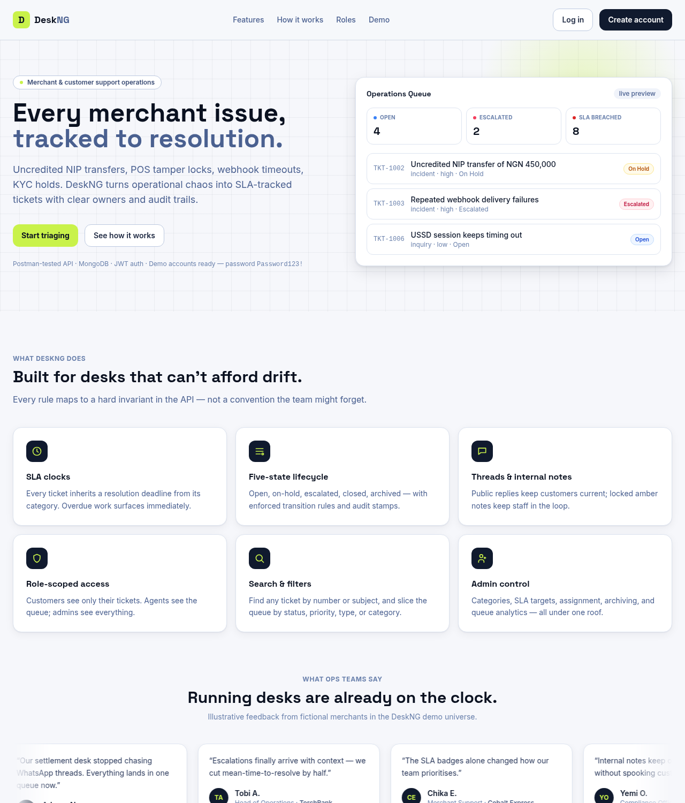

**Landing — mobile layout** (390×844)

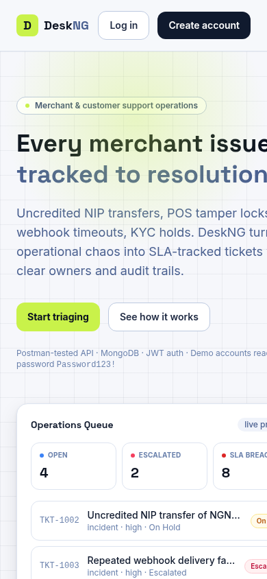

**Login — split-screen with quick-fill demo roles**

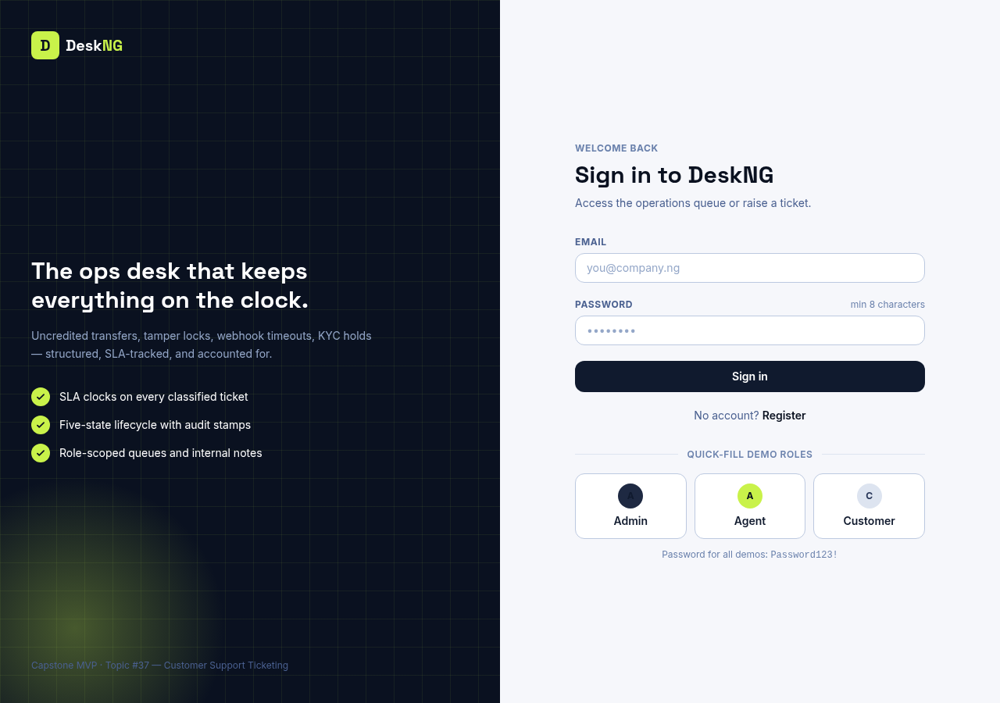

**Register — with live password-rule checklist**

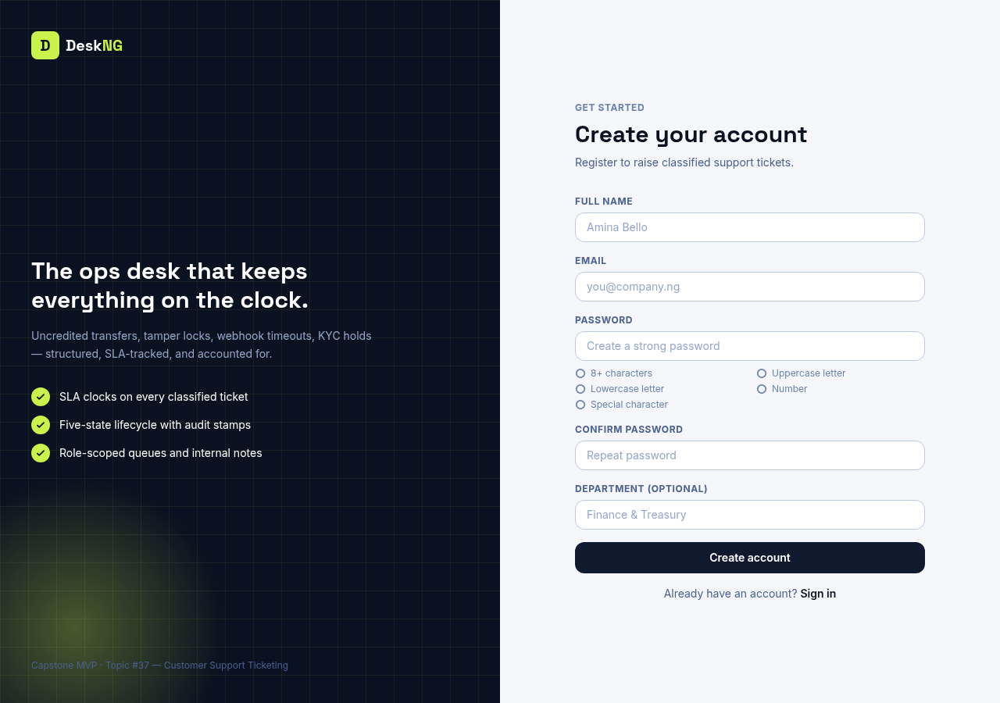

---

## Queue

**Operations Queue (Admin) — KPI bar, filters, paginated SLA
table**

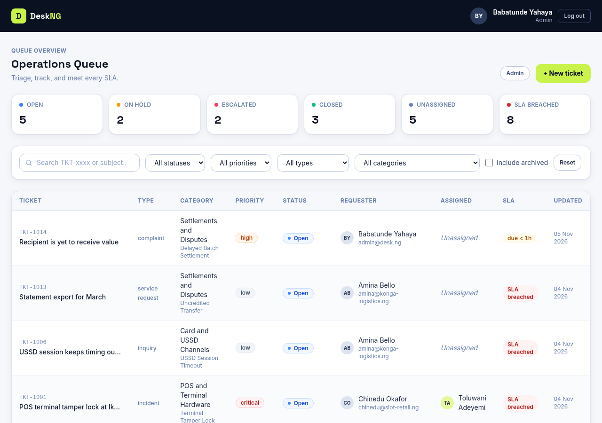

**Operations Queue — mobile layout**

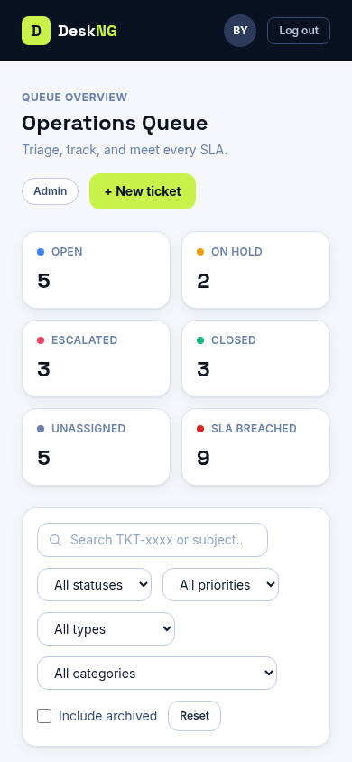

**My Tickets (Customer) — role-scoped queue**

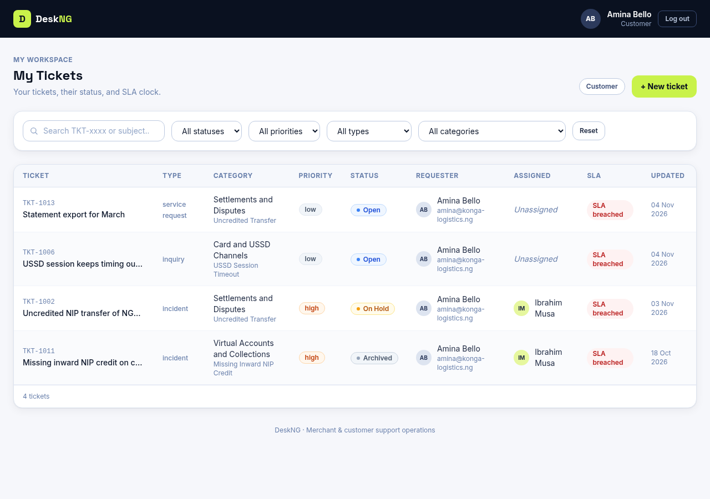

---

## Ticket Workspace

**Ticket detail (Agent/Admin) — escalated ticket with reason
banner, thread with internal agent note, transitions, assignment
sidebar**

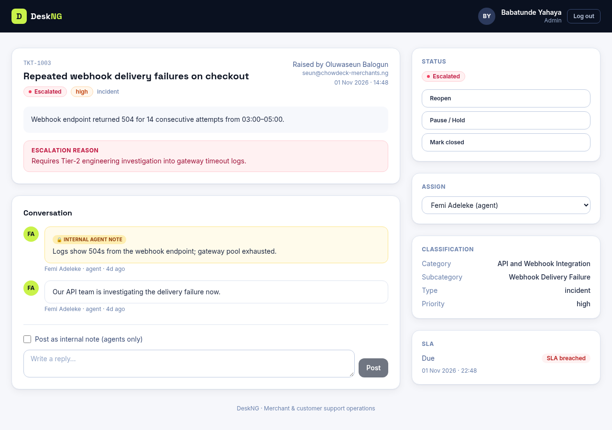

**Ticket detail (Customer) — same ticket as seen by the customer:
internal note hidden, public thread only**

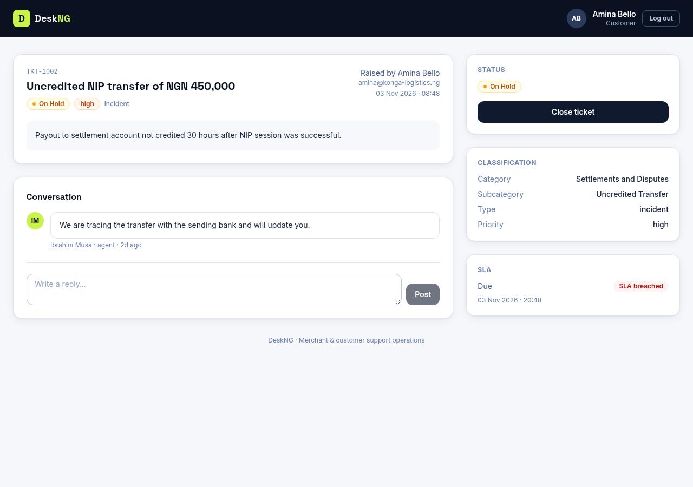

**Ticket detail — archived ticket (locked, no composer)**

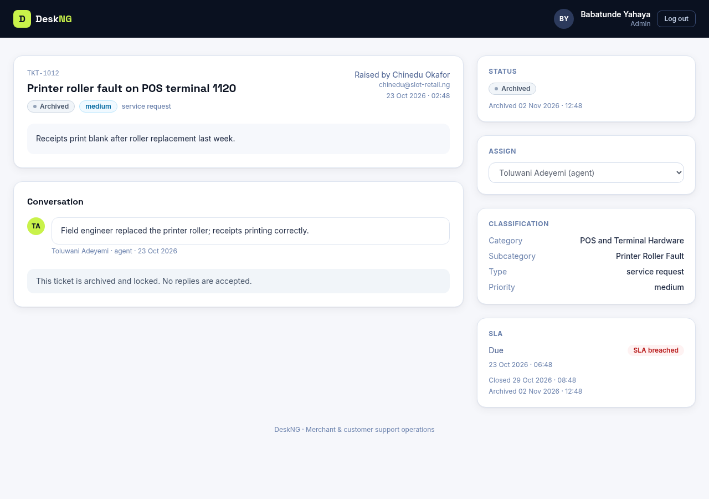

---

## Create Ticket

**Create ticket — category-to-subcategory cascade with SLA
preview**

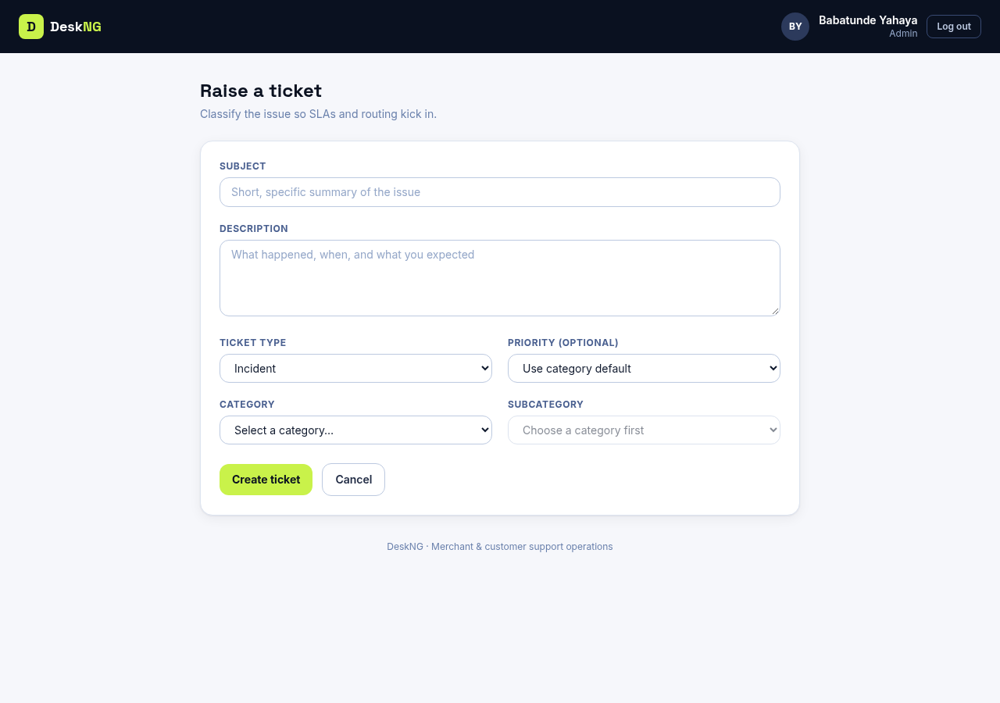

---

## Admin

**Category & SLA manager — cards with edit/activate controls**

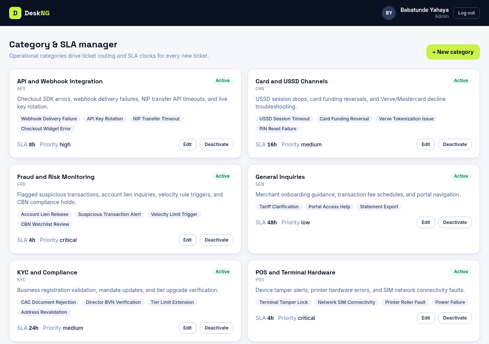
